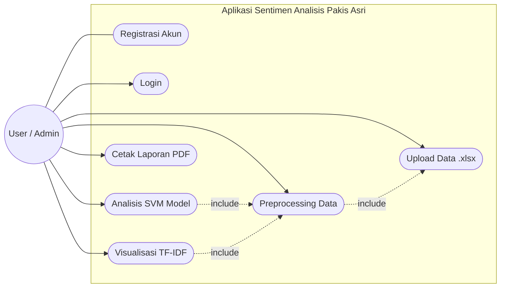
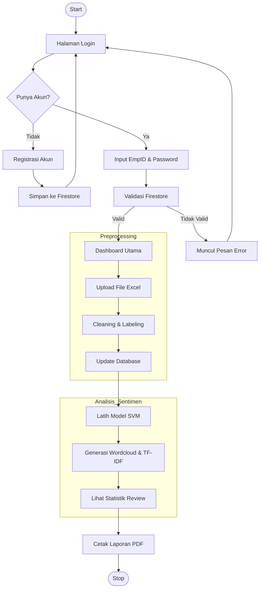
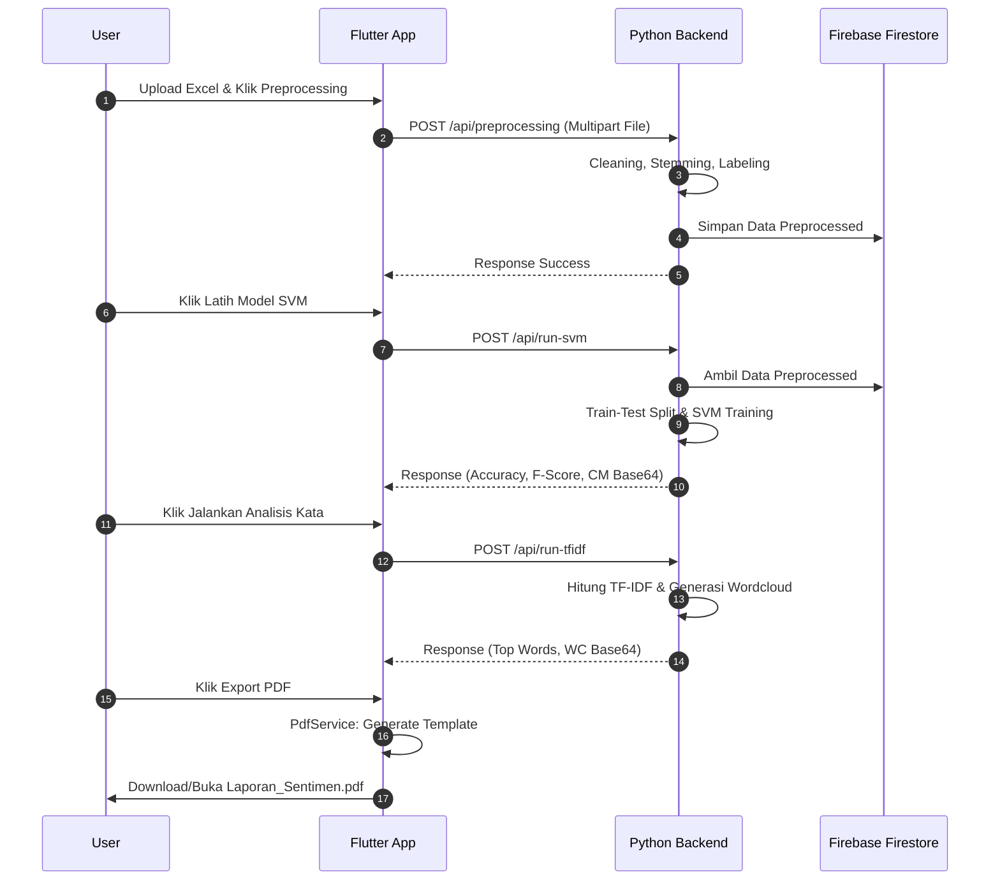
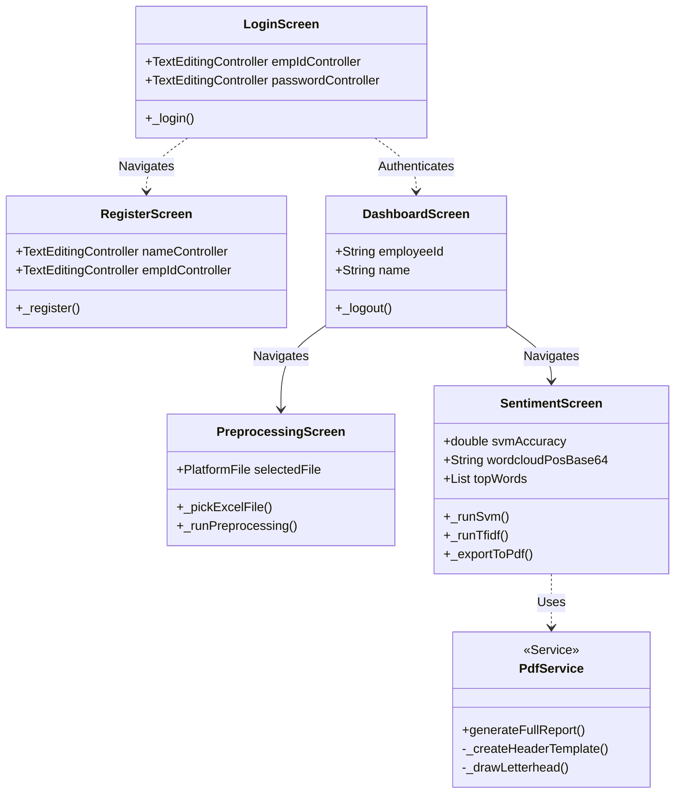

# Dokumentasi Perancangan Sistem

Dokumen ini berisi diagram teknis untuk aplikasi **Sentimen Analisis Rumah Wisata Pakis Asri**.

> [!TIP]
> **Cara Mengubah ke Draw.io:**
> 1. Buka [app.diagrams.net](https://app.diagrams.net/).
> 2. Klik menu **+ (Insert)** > **Advanced** > **Mermaid**.
> 3. Salin kode Mermaid di bawah ini ke kotak yang tersedia dan klik **Insert**.

---

## 1. Use Case Diagram
Menggambarkan fungsionalitas sistem dari sudut pandang pengguna menggunakan format Flowchart (kompatibel luas).

---

## 2. Activity Diagram
Menggambarkan alur kerja (workflow) aplikasi secara keseluruhan menggunakan format Flowchart TD.

---

## 3. Sequence Diagram
Menggambarkan interaksi antara Flutter (Frontend), FastAPI (Backend), dan Firestore (Database).

---

## 4. Class Diagram
Menggambarkan struktur class dan hubungan antar modul pada Flutter.

